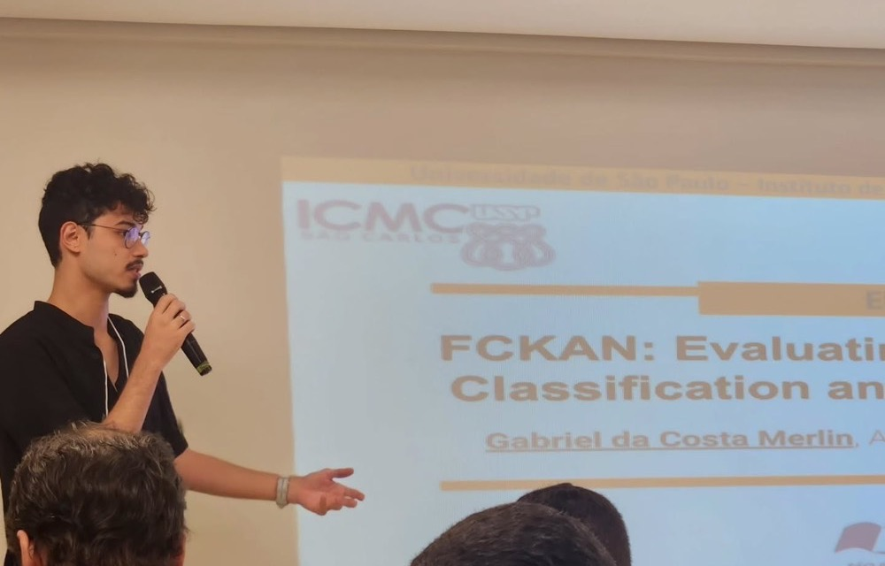

Presentation of the paper [FCKAN: Evaluating KAN for Time Series Classification and Extrinsic Regression](https://sol.sbc.org.br/index.php/eniac/article/view/38846){:target="_blank" rel="noopener noreferrer"} at ENIAC 2025, co-located with BRACIS 2025, in Fortaleza, Brazil.

{: .talk-photo}
